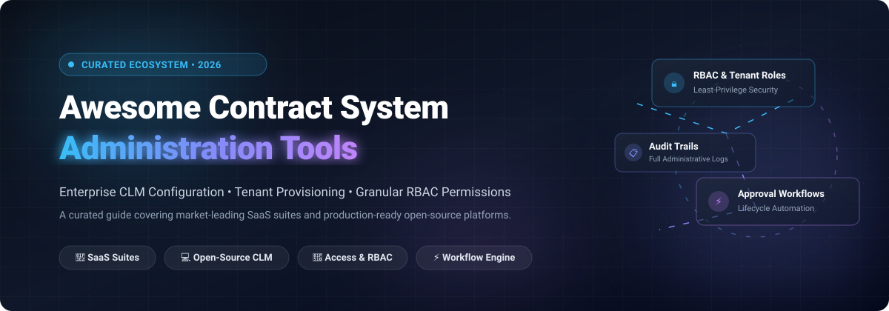

# Awesome Contract System Administration Tools 🛠️

  

 

**Curated List of SaaS Platforms & Open-Source Projects for Contract System Administration, CLM Tenant Management & Granular Permission Control** 📋✨  
*Focused on Tenant Configuration, User Provisioning, Access Governance, Security Controls & Workflow Engine Administration*  
**Last updated: March 2026** 📅

---

## 📖 Overview & Ecosystem Scope

This repository provides an authoritative, SEO-optimized directory of notable **commercial SaaS platforms** and production-ready **open-source GitHub projects** specifically built for **Contract System Administration Tools** and **Contract Lifecycle Management (CLM) Infrastructure**. 

System administration is the operational and security backbone of enterprise contract management:
- 🔐 **Tenant Configuration & Multi-Tenancy**: Organizational modeling, business unit scoping, and multi-region deployment setup.
- 👥 **Identity, Provisioning & Access Governance**: Granular role-based access control (RBAC), delegated admin permissions, SCIM user provisioning, SAML/OIDC SSO, and zero-trust security postures.
- ⚡ **Workflow & Automation Engine Administration**: Custom stage-gate approvals, threshold-based escalation rules, conditional routing, and automated execution policies.
- 📝 **Template, Clause & Metadata Administration**: Enterprise clause library governance, fallback rules, metadata schema design, dynamic token binding, and versioning.
- 🔍 **Auditability & Compliance Operations**: Immutable event feeds, administrative change logs, tamper-evident e-signature tracking, and exportable regulatory compliance artifacts.

---

## 📊 Sector Overview & Market Dynamics

The global Contract Lifecycle Management (CLM) software market was valued at **$1.6B–$1.8B in 2024** and is expanding to **$3.2B–$5.7B by 2030 at a CAGR of ~11.6%–12.7%**. The sector is currently **moderately to highly fragmented** across 150+ providers—ranging from niche repository and e-signature point solutions to massive enterprise legal suites—yet it is actively consolidating around market leaders (such as DocuSign, Icertis, and Ironclad) that are acquiring generative AI and automation startups to create comprehensive, unified workflow platforms.

---

## 📑 Table of Contents
- [📖 Overview & Ecosystem Scope](#-overview--ecosystem-scope)
- [📊 Sector Overview & Market Dynamics](#-sector-overview--market-dynamics)
- [🏢 SaaS & Hosted Platforms](#-saas--hosted-platforms)
- [💻 Open-Source GitHub Projects](#-open-source-github-projects)
- [🛠️ Frameworks for Custom CLM Administration](#️-frameworks-for-custom-clm-administration)
- [🤝 How to Contribute](#-how-to-contribute)
- [💖 Support](#-support)
- [📈 Star History](#-star-history)
- [⚠️ Disclaimer](#️-disclaimer)

---

## 🏢 SaaS & Hosted Platforms

*Commercial platforms sorted by company scale (market capitalization / valuation / annual revenue, descending).*

| Product | Company Scale (Valuation / Revenue) | Description | Pricing (Starting Tier) | Free Tier / Free Trial Limits |
|---------|------------------------------------|-------------|-------------------------|-------------------------------|
| **[Docusign CLM](https://www.docusign.com/)** | **~$14.5B Market Cap** (~$3.2B ARR; NASDAQ: DOCU) | Super administrators configure account settings across Automation Tools (Workflows, Smart Rules, Schedules), Documents & Folders (Attributes, Document Types, Auto Numbers), User Management (Users, Groups, Delegated Permissions), Account Management (Branding, Security Settings), and Integrations (SAML SSO, API Settings). | From $10,000/year (entry mid-market tier; enterprise packages scale from $50,000/year) | eSignature offers 30-day free trial (Business Pro features); Docusign CLM has no free tier or trial (0 days; sales demo only) |
| **[Icertis](https://www.icertis.com/)** | **~$5.0B Valuation** (~$350M ARR; Profitable) | Enterprise CLM with enterprise-grade security and administration to manage highly sensitive confidential contracts. Administration covers organization modeling, workflow configuration, clause/template management, and rule-based approvals. SAP-endorsed with 100-user minimum and 3-year contract commitment. | From ~$150,000/year (minimum 100 users, 3-year enterprise commitment; ~$200,000/3-yr marketplace baseline) | No free tier or trial (0 days; evaluation strictly via guided sales demo) |
| **[Ironclad](https://ironcladapp.com/)** | **~$3.2B Valuation** (~$200M ARR milestone) | CLM with a dedicated admin training curriculum covering user/group management, permission configuration, and repository administration. Admins configure record permissions per-record and per-record-type, manage obligations, renewals, and contract families. | From $50,000/year (equivalent to ~$200–$600/user/month depending on role; annual commitment) | No free tier or trial (0 days; evaluation strictly via scheduled sales demo) |
| **[SirionLabs](https://www.sirion.ai/)** | **~$1.0B Valuation** (~$85M ARR; Haveli majority) | CLM configuration covering user roles, approval workflows, and signature permissions. Enforces signing authority by contract type or value with real-time role updates and audit trails. | From £120/user/month (~$150/user/month, or ~$25,000/year platform baseline) | No free tier or trial (0 days; evaluation strictly via sales demo) |
| **[Agiloft](https://www.agiloft.com/)** | **~$71.4M ARR** (KKR Majority-backed, scaled) | No-code CLM platform where administrators can modify components without requiring development assistance. Admin capabilities include user management, group permissions, contract template management, clause library management, and integration support. Offers "Admin on demand" fractional administrators for day-to-day operations. | Astra AI add-on from $120/month; Core CLM platform starts at ~$67,000/year (annual contract) | Astra add-on has free tier; Core CLM has no free tier or trial (0 days; evaluation via sales demo) |
| **[CobbleStone](https://www.cobblestonesoftware.com/)** | **~$26.5M ARR** (Established CLM pioneer) | CLM with security groups defining user roles and bulk permission assignment. Admins configure field restrictions, hidden fields, and scope options (My, My Department, All). | From $59/user/month | 30-day free trial (sandbox evaluation environment with core repository & workflow features; no permanent free tier) |
| **[ContractWorks](https://www.contractworks.com/)** | **~$20M+ Segment** (Part of Onit legal suite) | Contract management with administrative controls for user permissions, custom fields, and alert configurations. SOC 2 Type 2 certified. | Standard Plan: $600/month (billed annually at ~$7,200/year, up to 50,000 documents, unlimited users) | 14-day free trial (unlimited document upload & AI tagging testing, no credit card required; no permanent free tier) |
| **[ContractSafe](https://www.contractsafe.com/)** | **SMB Tier** (Niche contract repository) | Contract repository with admin controls over AI extraction settings, custom fields, and user permissions. Admins control which AI features are enabled and which fields are active. | Organize Plan: $450/month (billed annually, up to 100 active contracts, unlimited users) | 7-day free trial (full platform feature access, no credit card required; no permanent free tier) |

---

## 💻 Open-Source GitHub Projects

*Self-hosted contract management suites, e-signature engines, and AI contract administration platforms sorted strictly by GitHub_Stars (descending).*

| Project | Stars_Badge | Description |
|---------|------------|-------------|
| **[DocuSeal](https://github.com/docusealco/docuseal)** |  | Open-source platform for creating, filling, and signing digital contracts and PDF forms. Admin capabilities include user role governance, signature workflows, PDF form builders, automated notifications, webhooks, and embedded signing widgets. Fully self-hostable via Docker Compose. |
| **[Documenso](https://github.com/documenso/documenso)** |  | The open-source DocuSign alternative built with TypeScript and Next.js. Provides administrative control over multi-signer contract workflows, team workspaces, cryptographic audit trails, signing certificates, and flexible REST APIs. |
| **[OpenSign](https://github.com/OpenSignLabs/OpenSign)** |  | Free and open-source e-signature and contract execution platform. Offers comprehensive administrative features including team role management, guest signer OTP verification, tamper-evident audit logs, custom fields, and multi-party signing pipelines. |
| **[OpenContracts](https://github.com/Open-Source-Legal/OpenContracts)** |  | Open-source document intelligence and contract management system tailored for legal corpus operations. Features document annotation, OCR parsing, vector search, role-based corpus permissions, and Model Context Protocol (MCP) endpoints for agentic legal workflows. |
| **[claude-legal-skill](https://github.com/evolsb/claude-legal-skill)** |  | AI-powered contract review skill with CUAD risk detection, market benchmarks, and lawyer-ready redlines. Operates as an administrative contract review engine compatible with Claude Code, Cursor, Codex, and automated developer CLI workflows. |
| **[awesome-legaltech](https://github.com/Vaquill-AI/awesome-legaltech)** |  | Curated index of open-source legal technology, contract analysis platforms, automated lifecycle tools, and legal NLP datasets for administrative engineering. |
| **[Prism-Legal-OS](https://github.com/FuturixAI-and-Quantum-Works/Prism-Legal-OS)** |  | Open-source legal AI operating system for contract analysis, clause extraction, legal research, and automated compliance tracking with dedicated role and model configuration panels. |
| **[draftLegal](https://github.com/AniketTati/draft-legal)** |  | Self-hosted AI-native CLM with approval workflows, in-platform e-signature, and post-signature obligation tracking. Admin controls for model provider configuration (Anthropic, OpenAI, Gemini) and local deployment via Docker Compose. |
| **[Edictum Console](https://github.com/edictum-ai/edictum-console)** |  | Self-hostable operations console for governed AI agents with a versioned contract library, human-in-the-loop (HITL) approvals, audit feeds, and fleet monitoring. Deployed via a single Docker image with FastAPI and React. |
| **[Aakd](https://github.com/aaked-app/aakd)** |  | Open-source, self-hostable CLM with organization-scoped approvals, comments, notifications, and activity logs. Admin capabilities include contract repository management, OCR, folders, tags, version history, role-based approval routing, and REST/MCP endpoints. |
| **[Shillinq](https://github.com/ConductionNL/shillinq)** |  | Open-source business administration suite for Nextcloud combining bookkeeping, invoicing, procurement, and contract lifecycle management. Features granular user role permissions, supplier qualification questionnaires, and PO revision management. |

---

## 🛠️ Frameworks for Custom CLM Administration

For organizations seeking absolute data sovereignty and air-gapped security, open-source building blocks can be orchestrated into custom enterprise contract administration stacks:
1. **Repository & Intelligence Layer**: Deploy **OpenContracts** or **Aakd** for document ingestion, OCR parsing, metadata schema modeling, and full-text search.
2. **E-Signature & Execution Layer**: Integrate **DocuSeal** or **OpenSign** to handle multi-party signature routing, signer verification, and cryptographic audit log storage.
3. **AI Review & Policy Enforcement**: Hook **claude-legal-skill** or **draftLegal** into your review pipelines for automated clause deviation checking, playbook matching, and redlining before human approval.
4. **Operations & Governance Console**: Use **Edictum Console** or **Shillinq** to administer team roles, track activity logs, and maintain regulatory compliance.

---

## 🤝 How to Contribute

Contributions are warmly welcomed! Help keep this curated list the premier resource for contract system administrators and legal operations engineers:

1. 🍴 **Fork** the repository.
2. 🌿 Create a feature branch: `git checkout -b feature/new-admin-tool`.
3. 📝 Add your entry to the appropriate table (ensure open-source tools include social Stars_Badges linked to stargazers and maintain strict descending order).
4. 🚀 Submit a **Pull Request** with a brief summary of administrative features.

---

## 💖 Support

If you find this curated collection helpful for your legal ops, system architecture, or CLM evaluation workflows:
- ⭐ **Star** this repository on GitHub!
- 🍴 **Fork** and share it with colleagues in legal tech and DevOps.
- ☕ Consider buying a coffee to support continued maintenance and curation:  
  👉 **[Sponsor on GitHub](https://github.com/sponsors/ishandutta2007)**

---

## 📈 Star History

---

## ⚠️ Disclaimer

- This is a **community-curated list** — provided for educational, architectural, and informational purposes only and does not constitute formal legal or software procurement endorsement.
- Contract system administration tools govern access to legally sensitive agreements and trade secrets. Organizations should always enforce least-privilege permissions, mandatory multi-factor authentication (MFA), role separation, and comprehensive audit log archiving for administrative users.
- Commercial CLM administrative features are generally bundled with enterprise subscriptions. Open-source solutions offer total code auditability and data sovereignty, but require internal DevOps resources for maintenance, backups, and security patching. Always validate tools against your organization's compliance standards (SOC 2, ISO 27001, GDPR, HIPAA) before production rollout.

---

**Built with ❤️ for CLM Administrators, Legal Ops Leaders, IT Systems Engineers, and LegalTech Developers.**  
*Empowering transparent, auditable, and secure contract infrastructure everywhere.*

